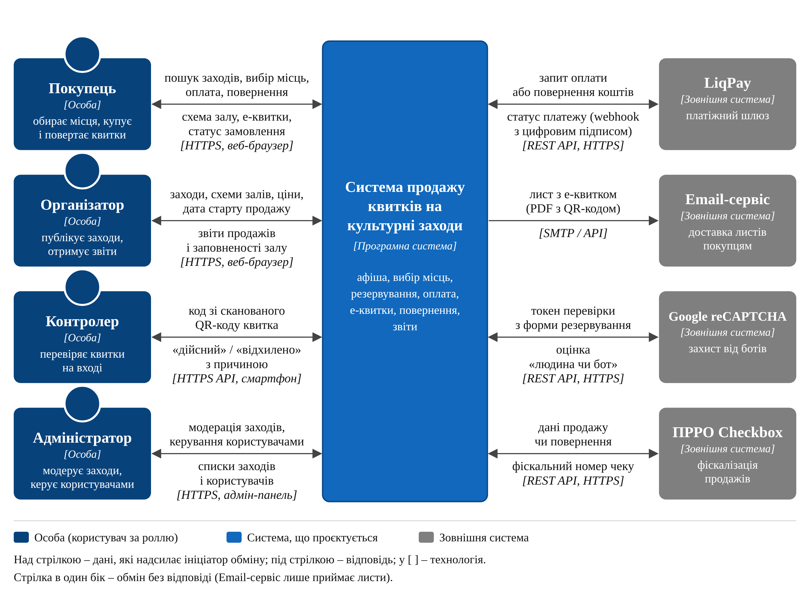

# 🎭 Система продажу квитків на культурні заходи – наскрізний проєкт

> Вебсистема для продажу квитків на концерти, вистави, кінопокази та виставки: афіша, вибір місць на схемі залу, резервування, онлайн-оплата, електронні квитки з QR-кодом і перевірка квитків на вході.

Навчальний проєкт з дисципліни **«Архітектура та проєктування програмного забезпечення»**, який команда розвиває протягом циклу лабораторних робіт № 1–8. Тема – варіант № 18 переліку предметних областей.

## Команда (НУ «ОЮА», група ІПЗ412)

| Учасник | Роль у ЛР 1 | Роль у ЛР 2 | Роль у ЛР 3 | Роль у ЛР 4 | Роль у ЛР 5 |
| --- | --- | --- | --- | --- | --- |
| **Пакін Денис Сергійович** | Архітектор | Аналітик домену | Інженер з якості | Архітектор | Аналітик домену |
| **Шавейко Олександр Леонідович** | Аналітик домену | Інженер з якості | Архітектор | Аналітик домену | Інженер з якості |
| **Пащенко Олександр Анатолійович** | Інженер з якості | Архітектор | Аналітик домену | Інженер з якості | Архітектор |

Викладач: Ніколаєнко С.В.

## Архітектура коротко

| | |
| --- | --- |
| **Архітектурний стиль** | Три сервіси за доменними контекстами (sales, payments, tickets), шлюз і брокер подій ([ADR-004](docs/adr/0004-service-boundaries-and-interaction.md), замінює [ADR-001](docs/adr/0001-architecture-style.md)); інтерфейс із ролями – окремий сервіс web на Meteor ([ADR-006](docs/adr/0006-web-ui-meteor.md)) |
| **Технологічний стек** | Python 3.12, Django 5, PostgreSQL 16 (sales), SQLite (payments, tickets), Redis 7 (Streams і кеш), nginx, Docker Compose ([ADR-002](docs/adr/0002-technology-stack.md), [ADR-005](docs/adr/0005-sales-storage-postgresql.md)) |
| **Найкритичніший атрибут якості** | Надійність: жодного подвійного продажу місця і жодного втраченого оплаченого замовлення |
| **Зовнішні інтеграції** | LiqPay, Email-сервіс, Google reCAPTCHA, ПРРО Checkbox |



## Лабораторна робота № 1: Архітектурний контекст системи та обґрунтування архітектурного стилю

| Розділ звіту | Документ |
| --- | --- |
| 1. Мета роботи та предметна область | [docs/domain-overview.md](docs/domain-overview.md) |
| 2. Глосарій (15 термінів) | [docs/glossary.md](docs/glossary.md) |
| 3. Зацікавлені сторони та суперечності | [docs/stakeholders.md](docs/stakeholders.md) |
| 4. Межі системи, діаграма контексту C4, інтеграції | [docs/c4-context.md](docs/c4-context.md) |
| 5. Сценарії атрибутів якості (9 сценаріїв) | [docs/quality-scenarios.md](docs/quality-scenarios.md) |
| 6. Критерії та порівняння альтернатив | [docs/architecture-comparison.md](docs/architecture-comparison.md) |
| 7. Записи архітектурних рішень | [docs/adr/](docs/adr/) |
| 8. Висновки, ризики, відкриті питання | [docs/risks-and-open-questions.md](docs/risks-and-open-questions.md) |
| Звіт (DOCX) | [docs/reports/lab1-report.docx](docs/reports/lab1-report.docx) |

### Записи архітектурних рішень (ADR)

- [ADR-001: Архітектурний стиль – модульний моноліт з фоновими обробниками](docs/adr/0001-architecture-style.md) (замінено ADR-004)
- [ADR-002: Технологічний стек – Python, Django, PostgreSQL, Celery, Redis](docs/adr/0002-technology-stack.md)
- [ADR-003: Доменна модель відокремлена від Django ORM](docs/adr/0003-domain-independent-of-orm.md)
- [ADR-004: Межі сервісів за доменними контекстами та способи їх взаємодії](docs/adr/0004-service-boundaries-and-interaction.md)
- [ADR-005: Сховище sales – PostgreSQL з доступом через SQL, власні міграції та транзакційна вихідна черга](docs/adr/0005-sales-storage-postgresql.md)
- [ADR-006: Інтерфейс користувачів – окремий сервіс web на Meteor з ролями та токеном доступу](docs/adr/0006-web-ui-meteor.md)

Записи зберігаються в каталозі [`docs/adr/`](docs/adr/). Прийняті записи не редагуються заднім числом: перегляд рішення оформлюється новим записом зі статусом «замінює ADR-00N» (правила – у [docs/adr/README.md](docs/adr/README.md)).

## Лабораторна робота № 2: Реалізація багатошарового ядра системи

Стан коду ЛР 2 зафіксовано тегом `lab-2`. У ЛР 3 пакет `ticketing/` став сервісом `sales/`, а квитки й контроль на вході винесено в сервіс `tickets/`; багатошарова структура збережена в кожному сервісі.

| Шар | Відповідальність | Може залежати від |
| --- | --- | --- |
| Presentation (подання) | Django views, шаблони; перетворення запиту на DTO і виклик сценарію | application |
| Application (застосунок) | Сценарії використання, вхідні/вихідні DTO, транзакційні межі | domain |
| Domain (домен) | Сутності, об'єкти-значення, доменні правила, інтерфейси репозиторіїв | лише стандартна бібліотека Python |
| Infrastructure (інфраструктура) | Реалізації інтерфейсів домену | domain |
| Точка складання (`config/container.py` у кожному сервісі) | Створення реалізацій і передавання їх у сценарії (DI) | усі шари свого сервісу |

Рішення про відокремлення доменної моделі від Django ORM – [ADR-003](docs/adr/0003-domain-independent-of-orm.md). Звіт (DOCX): [docs/reports/lab2-report.docx](docs/reports/lab2-report.docx).

## Лабораторна робота № 3: Декомпозиція системи на сервіси та проєктування контрактів взаємодії

### Сервіси та їхні дані

| Сервіс | Доменний контекст | Власні дані | Каталог |
| --- | --- | --- | --- |
| sales | Продаж: схема залу, резервування, замовлення | у ЛР 3 – пам'ять процесу; з ЛР 5 – PostgreSQL 16, том `sales-data` | [`sales/`](sales/) |
| payments | Оплати: списання коштів, ідемпотентність за `order_id` | SQLite, том `payments-data` | [`payments/`](payments/) |
| tickets | Доступ на захід: видача квитків, контроль на вході | SQLite, том `tickets-data` | [`tickets/`](tickets/) |
| gateway | Шлюз nginx – єдина точка входу | – | [`gateway/`](gateway/) |
| redis | Брокер подій (Redis Streams) | потік `sales.order-paid.v1` | – |

Обґрунтування меж за індикаторами, перевірка змінами вимог і власники сутностей – [docs/lab3/service-boundaries.md](docs/lab3/service-boundaries.md). Рішення – [ADR-004](docs/adr/0004-service-boundaries-and-interaction.md).

Звіт (DOCX): [docs/reports/lab3-report.docx](docs/reports/lab3-report.docx)

### Взаємодія

| Вид | Хто → кому | Контракт | Захист |
| --- | --- | --- | --- |
| Синхронна | sales → payments, `POST /v1/payments` | [contracts/payments.openapi.yaml](contracts/payments.openapi.yaml) | тайм-аут 2 с, стан «оплата в обробці», ідемпотентність за `order_id` |
| Асинхронна | sales → tickets, подія `OrderPaid` v1 | [contracts/order-paid.asyncapi.yaml](contracts/order-paid.asyncapi.yaml) | вихідна черга, група споживачів Redis Streams, підтвердження після обробки, ідемпотентний споживач |

### Перевірка

- 142 автоматичні тести: доменні правила кожного сервісу без бази даних, сценарії, сховища, HTTP-клієнт із тайм-аутом, відповідність API й повідомлень контрактам.
- `lint-imports`: сервіси не імпортують один одного; шари всередині кожного сервісу; домен і застосунок без Django.
- Експеримент із вимкненими payments, споживачем tickets, Redis і веб-процесом tickets – [docs/lab3/experiment.md](docs/lab3/experiment.md).

### Запуск і перевірка

Уся система (потрібен Docker Desktop):

```
docker compose up --build
```

Після запуску відкрийте http://localhost:8080/ – вибір місць, оплата, «Мої квитки», контроль на вході (`/validate/`). Збій окремого сервісу імітується командами `docker compose stop <сервіс>` і `docker compose start <сервіс>`.

Тести й перевірка залежностей (інтеграційним тестам sales потрібен контейнер `sales-db`; без нього вони пропускаються):

```
py -3.12 -m venv .venv
.venv\Scripts\activate
pip install -r requirements.txt
docker compose up -d sales-db
python -m pytest
lint-imports
```

## Лабораторна робота № 4: Застосування патернів проєктування в рефакторингу коду

Чотири проблеми коду ЛР 3 усунено поетапним рефакторингом; поведінку зафіксовано характеризаційними тестами до змін, наявні тести не змінювались. Повний опис – [docs/lab4/patterns.md](docs/lab4/patterns.md).

| № | Проблема | Патерн (група) | Головний показник до → після |
| --- | --- | --- | --- |
| К-1 | правила оплати – умови за станом у чотирьох методах `Order` | State (поведінковий) | гілки в методах оплати `Order`: 6 → 0 |
| К-2 | споживач `OrderPaid` напряму залежить від API redis-py | Adapter (структурний) | місця зміни при зміні API Redis: 4 → 1 |
| К-3 | створення заходу – ручне узгодження ключів і вкладені цикли | Builder (породжувальний) | цикли в `seed_demo_event`: 3 → 0 |
| К-4 | контейнер sales жорстко створює HTTP- і Redis-клієнти | Factory Method (породжувальний) | тест складання з оплатою без мережі: ні → так |

Показники вимірює скрипт `tools/measure.py`; результати – `docs/lab4/metrics-before.txt` і `metrics-after.txt`.

Звіт (DOCX): [docs/reports/lab4-report.docx](docs/reports/lab4-report.docx)

## Лабораторна робота № 5: Архітектура даних – володіння, кешування та узгодженість

Повний опис – [docs/lab5/data-architecture.md](docs/lab5/data-architecture.md), рішення про сховище sales – [ADR-005](docs/adr/0005-sales-storage-postgresql.md).

| Вимога методички | Реалізація | Доказ |
| --- | --- | --- |
| Модель даних кожного сервісу | sales – PostgreSQL 16 (агрегати Event, Reservation, Order, таблиця `outbox`); payments і tickets – SQLite | діаграми `docs/lab5/model_*.png` |
| Матриця володіння | у кожної сутності один власник; копії – лише з подій чи запитів | `data-architecture.md`, розділ 2 |
| Локальна копія | квиток у tickets: `order_id`, `event_id`, позиція місця з події `OrderPaid` | розділ 3 |
| Міграція «розширення – скорочення» | payments: сума `amount TEXT` → `amount_minor INTEGER`, міграції 0002–0004 | тести сумісності версій коду після кожної міграції |
| Кеш із явною інвалідизацією | схема залу в Redis, ключ `sales:hall-layout:v1:{event_id}`, видалення після фіксації, 30 с | p50 −17–24 %, транзакцій бази на перегляд −95 % |
| Узгодження через подію | транзакційний outbox у sales, ідемпотентний обробник `OrderPaid` у tickets | повторне надсилання події не змінює квитків; вікно неузгодженості ≤ 1 с |

Вимірювання: `tools/latency.py`, `tools/compare_cache.py`, `tools/order_paid_lag.py`; повторне надсилання події – `tools/resend_last_order_paid.py`.

## Інтерфейс користувачів на Meteor (доробка після ЛР 5)

Сервіс **web** ([`web/`](web/), Meteor 3 + React) – вхід, реєстрація й чотири ролі з глосарію ЛР 1. Рішення – [ADR-006](docs/adr/0006-web-ui-meteor.md): web володіє обліковими записами й ролями (власна MongoDB), а заходи, замовлення й квитки отримує лише через JSON API sales і tickets, підписуючи на кожен виклик короткий JWT із `subjectId` і ролями користувача. Браузер до сервісів напряму не звертається, шлюз закриває `/api/` ззовні.

| Роль | Можливості | JSON API |
| --- | --- | --- |
| Покупець | реєстрація, афіша, схема залу, резервування до 6 місць, оплата, «Мої замовлення» з QR-кодами квитків | sales: `/events`, `/events/{id}`, `/events/{id}/reservations`, `/orders`, `/orders/{id}/payment`; tickets: `/orders/{id}/tickets` |
| Організатор | створення заходу (сектори, ряди, ціни, дати), статистика продажу своїх заходів | sales: `POST /events`, `/organizer/events` |
| Контролер | перевірка коду квитка на вході обраного заходу | tickets: `/validations` |
| Адміністратор | ролі й блокування користувачів, статистика всіх заходів | – (дані web) + sales: `/organizer/events` |

Контракти: [contracts/sales.openapi.yaml](contracts/sales.openapi.yaml), [contracts/tickets.openapi.yaml](contracts/tickets.openapi.yaml). Права перевіряються тричі: в інтерфейсі, у методі Meteor і в сервісі за роллю з токена.

**Запуск у Docker** – `docker compose up --build`, інтерфейс – http://localhost:8090/. Тестові облікові записи (лише для розробки; задаються змінними `ADMIN_EMAIL`, `ADMIN_PASSWORD`, `SEED_DEMO_USERS`):

| Роль | Пошта | Пароль |
| --- | --- | --- |
| Адміністратор | `admin@ticketsales.local` | `admin-dev-password` |
| Організатор | `organizer@ticketsales.local` | `organizer-dev-password` |
| Контролер | `inspector@ticketsales.local` | `inspector-dev-password` |
| Покупець | `buyer@ticketsales.local` | `buyer-dev-password` |

**Розробка з гарячим оновленням** – сервіси в Docker (`docker compose up -d`), Meteor локально (sales і tickets доступні з хоста лише на `127.0.0.1:8100` і `:8200`):

```
cd web
meteor npm install
$env:RSPACK_DEVSERVER_PORT="3010"
$env:SEED_DEMO_USERS="1"
meteor run
```

Інтерфейс – http://localhost:3000/. `RSPACK_DEVSERVER_PORT` потрібен, бо за замовчуванням сервер розробки Rspack займає порт 8080 шлюзу. На Windows перший запуск може впасти на збиранні `argon2` («'cross-env' is not recognized»): `meteor npm install -g cross-env` і один раз додати каталог `dev_bundle` Meteor до `PATH` вікна (`$env:Path = "$env:LOCALAPPDATA\.meteor\packages\meteor-tool\3.5.4\mt-os.windows.x86_64\dev_bundle;$env:Path"`).

Обмеження: автотестів інтерфейсу немає (перевірено вручну всі ролі); HS256 зі спільним секретом – для навчального проєкту (для експлуатації – RS256); tickets не знає покупця замовлення, власника перевіряє web у sales.

## Структура репозиторію

```
.
├── README.md
├── CHANGELOG.md
├── LICENSE
├── requirements.txt          # залежності сервісів і тестів
├── pyproject.toml            # контракти import-linter, налаштування pytest
├── compose.yaml              # шлюз, три сервіси, споживач подій, Redis, PostgreSQL sales, web і MongoDB
├── Dockerfile                # образ одного сервісу (аргумент SERVICE)
├── manage.py                 # локальний запуск sales
├── tools/                    # показники коду (ЛР 4), вимірювання часу відповіді й неузгодженості (ЛР 5)
├── gateway/nginx.conf        # маршрути шлюзу
├── contracts/                # OpenAPI payments, sales, tickets; AsyncAPI OrderPaid
├── web/                      # інтерфейс користувачів на Meteor 3 + React (ADR-006)
├── sales/                    # domain, application, infrastructure, presentation, config
├── payments/                 # domain, application, infrastructure, presentation, config
├── tickets/                  # domain, application, infrastructure, presentation, config (+ consumer.py)
├── tests/
│   ├── sales/  payments/  tickets/   # тести кожного сервісу за шарами
│   ├── contracts/            # коректність контрактів
│   └── architecture/         # напрямок залежностей у доменах сервісів
└── docs/
    ├── …                     # документи ЛР 1
    ├── lab3/                 # межі сервісів, експеримент
    ├── lab4/                 # патерни: проблеми, показники, діаграми класів
    ├── lab5/                 # архітектура даних: моделі, володіння, кеш, вимірювання
    ├── adr/                  # ADR-001 – ADR-006
    ├── assets/
    └── reports/              # звіти
```

## Релізи

Кожна лабораторна робота фіксується тегом `lab-N`. Історія змін – у [CHANGELOG.md](CHANGELOG.md).

| Тег | Лабораторна робота |
| --- | --- |
| `lab-1` | Архітектурний контекст системи та обґрунтування архітектурного стилю |
| `lab-2` | Реалізація багатошарового ядра системи |
| `lab-3` | Декомпозиція системи на сервіси та проєктування контрактів взаємодії |
| `lab-4` | Застосування патернів проєктування в рефакторингу коду |
| `lab-5` | Архітектура даних: володіння, кешування та узгодженість |

## Ліцензія

[MIT License](LICENSE) © 2026 Пакін Д.С., Шавейко О.Л., Пащенко О.А.