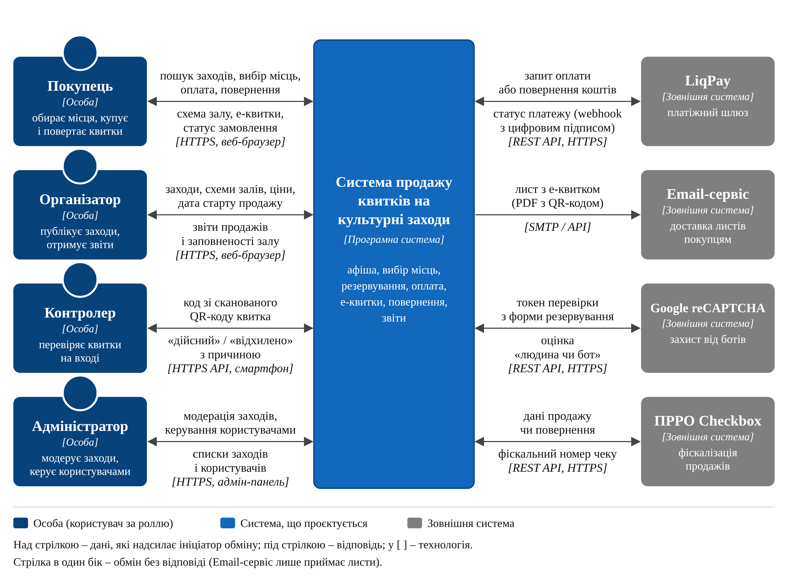

# 🎭 Система продажу квитків на культурні заходи – наскрізний проєкт

> Вебсистема для продажу квитків на концерти, вистави, кінопокази та виставки: афіша, вибір місць на схемі залу, резервування, онлайн-оплата, електронні квитки з QR-кодом і перевірка квитків на вході.

Навчальний проєкт з дисципліни **«Архітектура та проєктування програмного забезпечення»**, який команда розвиває протягом циклу лабораторних робіт № 1–8. Тема – варіант № 18 переліку предметних областей.

## Команда (НУ «ОЮА», група ІПЗ412)

| Учасник | Роль у ЛР 1 |
| --- | --- |
| **Пакін Денис Сергійович** | Архітектор |
| **Шавейко Олександр Леонідович** | Аналітик домену |
| **Пащенко Олександр Анатолійович** | Інженер з якості |

Викладач: Ніколаєнко С.В.

## Архітектура коротко

| | |
| --- | --- |
| **Архітектурний стиль** | Модульний моноліт з фоновими обробниками ([ADR-001](docs/adr/0001-architecture-style.md)) |
| **Технологічний стек** | Python 3.12, Django 5, PostgreSQL 16, Celery 5, Redis 7, Docker Compose ([ADR-002](docs/adr/0002-technology-stack.md)) |
| **Найкритичніший атрибут якості** | Надійність: жодного подвійного продажу місця і жодного втраченого оплаченого замовлення |
| **Зовнішні інтеграції** | LiqPay, Email-сервіс, Google reCAPTCHA, ПРРО Checkbox |



## Лабораторна робота № 1: Архітектурний контекст системи та обґрунтування архітектурного стилю

| Розділ звіту | Документ |
| --- | --- |
| 1. Мета роботи та предметна область | [docs/domain-overview.md](docs/domain-overview.md) |
| 2. Глосарій (15 термінів) | [docs/glossary.md](docs/glossary.md) |
| 3. Зацікавлені сторони та суперечності | [docs/stakeholders.md](docs/stakeholders.md) |
| 4. Межі системи, діаграма контексту C4, інтеграції | [docs/c4-context.md](docs/c4-context.md) |
| 5. Сценарії атрибутів якості (9 сценаріїв) | [docs/quality-scenarios.md](docs/quality-scenarios.md) |
| 6. Критерії та порівняння альтернатив | [docs/architecture-comparison.md](docs/architecture-comparison.md) |
| 7. Записи архітектурних рішень | [docs/adr/](docs/adr/) |
| 8. Висновки, ризики, відкриті питання | [docs/risks-and-open-questions.md](docs/risks-and-open-questions.md) |
| Звіт (DOCX) | [docs/reports/lab1-report.docx](docs/reports/lab1-report.docx) |

### Записи архітектурних рішень (ADR)

- [ADR-001: Архітектурний стиль – модульний моноліт з фоновими обробниками](docs/adr/0001-architecture-style.md)
- [ADR-002: Технологічний стек – Python, Django, PostgreSQL, Celery, Redis](docs/adr/0002-technology-stack.md)

Записи зберігаються в каталозі [`docs/adr/`](docs/adr/). Прийняті записи не редагуються заднім числом: перегляд рішення оформлюється новим записом зі статусом «замінює ADR-00N» (правила – у [docs/adr/README.md](docs/adr/README.md)).

## Лабораторна робота № 2: Реалізація багатошарового ядра системи

### Шари ядра та відповідність каталогів

| Шар | Каталог | Відповідальність | Може залежати від |
| --- | --- | --- | --- |
| Presentation (подання) | `ticketing/presentation/` | Django views, форми, шаблони; перетворення запиту на DTO і виклик сценарію | application |
| Application (застосунок) | `ticketing/application/` | Сценарії використання, вхідні/вихідні DTO, транзакційні межі | domain |
| Domain (домен) | `ticketing/domain/` | Сутності, об'єкти-значення, доменні правила, інтерфейси репозиторіїв | лише стандартна бібліотека Python |
| Infrastructure (інфраструктура) | `ticketing/infrastructure/` | Реалізації репозиторіїв (у ЛР 2 – у пам'яті), заглушка `PaymentGateway` | domain |
| Точка складання залежностей | `config/container.py` | Створення реалізацій і передавання їх у сценарії (DI) | усі шари |

Напрямок залежностей перевіряється автоматично: `lint-imports` та тест у `tests/architecture/`.

## Структура репозиторію

```
.
├── README.md
├── CHANGELOG.md
├── LICENSE
└── docs/
    ├── domain-overview.md          # мета, предметна область, процеси, сутності, обмеження
    ├── glossary.md                 # глосарій
    ├── stakeholders.md             # зацікавлені сторони
    ├── c4-context.md               # межі системи, діаграма контексту, інтеграції
    ├── quality-scenarios.md        # сценарії атрибутів якості
    ├── architecture-comparison.md  # критерії та порівняння альтернатив
    ├── risks-and-open-questions.md # висновки, ризики, відкриті питання
    ├── adr/
    │   ├── README.md               # реєстр і правила ведення ADR
    │   ├── template.md             # шаблон нового запису
    │   ├── 0001-architecture-style.md
    │   └── 0002-technology-stack.md
    ├── assets/
    │   └── c4-context.png
    └── reports/
        └── lab1-report.docx
```

Код системи (Django-проєкт) з'явиться починаючи з ЛР 2.

## Релізи

Кожна лабораторна робота фіксується тегом `lab-N`. Історія змін – у [CHANGELOG.md](CHANGELOG.md).

| Тег | Лабораторна робота |
| --- | --- |
| `lab-1` | Архітектурний контекст системи та обґрунтування архітектурного стилю |

## Ліцензія

[MIT License](LICENSE) © 2026 Пакін Д.С., Шавейко О.Л., Пащенко О.А.
