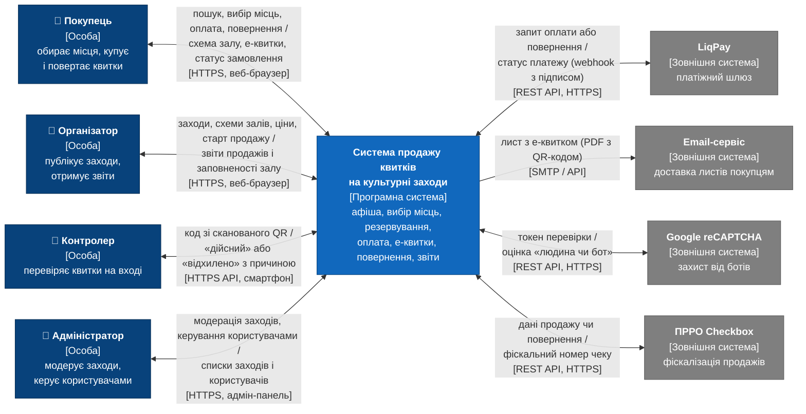

# Контекст системи – C4, рівень 1 (ЛР 1)

> Розділ 4 звіту. Аналітик домену: Шавейко О.Л.

Система зображена як єдиний елемент без внутрішньої будови: з нею працюють чотири ролі користувачів, а сама вона обмінюється даними з чотирма зовнішніми системами. Внутрішня будова (контейнери, компоненти) з'явиться в наступних лабораторних роботах.

## Межі системи

Межі визначають, які функції реалізує сама система, а які виконують зовнішні учасники. Ліва колонка проєктується командою; праву колонку система лише використовує через інтеграції.

| Входить до системи | Залишається поза системою |
| --- | --- |
| Каталог заходів, майданчиків і схем залів | Обробка платіжних карток і 3-D Secure (LiqPay) |
| Резервування місць і захист від подвійного продажу | Доставка листів до поштових скриньок покупців (Email-сервіс) |
| Оформлення замовлень, ініціювання оплати та повернення коштів | Розпізнавання ботів (Google reCAPTCHA) |
| Випуск електронних квитків з QR-кодом | Формування та реєстрація фіскальних чеків (ПРРО Checkbox) |
| Валідація квитків на вході | Смартфони контролерів і браузери користувачів |
| Звіти для організаторів, модерація, адміністрування | Фізичний пропуск глядачів до залу |

## Діаграма контексту

*Рисунок 4.1 – Діаграма контексту системи продажу квитків на культурні заходи (C4, рівень 1).*

Над кожною стрілкою вказано дані, які надсилає ініціатор обміну, під стрілкою – відповідь і технологію обміну. Обмін з Email-сервісом односторонній: система лише передає листи для доставки покупцям.

Текстове джерело діаграми (Mermaid, рендериться GitHub)

## Зовнішні системи та інтеграції

| Зовнішній елемент | Тип | Що передається | Спосіб обміну |
| --- | --- | --- | --- |
| Покупець | Користувач | Пошук заходів, вибір місць, замовлення, повернення; у відповідь – квитки та статуси | Веб-браузер, HTTPS |
| Організатор | Користувач | Дані заходів, схеми залів, ціни, дата старту продажу; у відповідь – звіти продажів | Веб-браузер, HTTPS |
| Контролер | Користувач | Код зі сканованого QR; у відповідь – «дійсний» або «відхилено» з причиною | Смартфон зі сканером, HTTPS API |
| Адміністратор | Користувач | Модерація заходів, керування користувачами, налаштування | Адмін-панель, HTTPS |
| LiqPay | Платіжний шлюз | Запит на оплату чи повернення коштів; у відповідь – статус платежу через webhook з цифровим підписом | REST API, HTTPS |
| Email-сервіс | Сервіс сповіщень | Листи з електронними квитками (PDF з QR-кодом) і підтвердженнями | SMTP / API провайдера |
| Google reCAPTCHA | Захист від ботів | Токен перевірки з форми резервування; у відповідь – оцінка «людина чи бот» | REST API, HTTPS |
| ПРРО Checkbox | Фіскалізація | Дані продажу чи повернення; у відповідь – фіскальний номер чеку | REST API, HTTPS |
