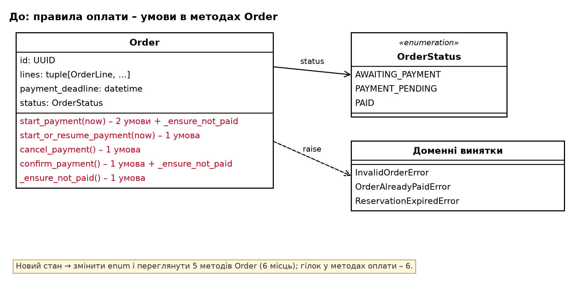
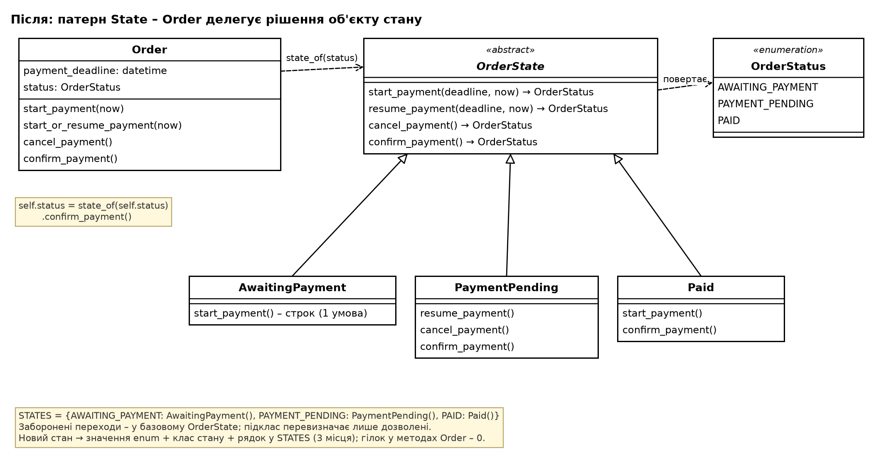
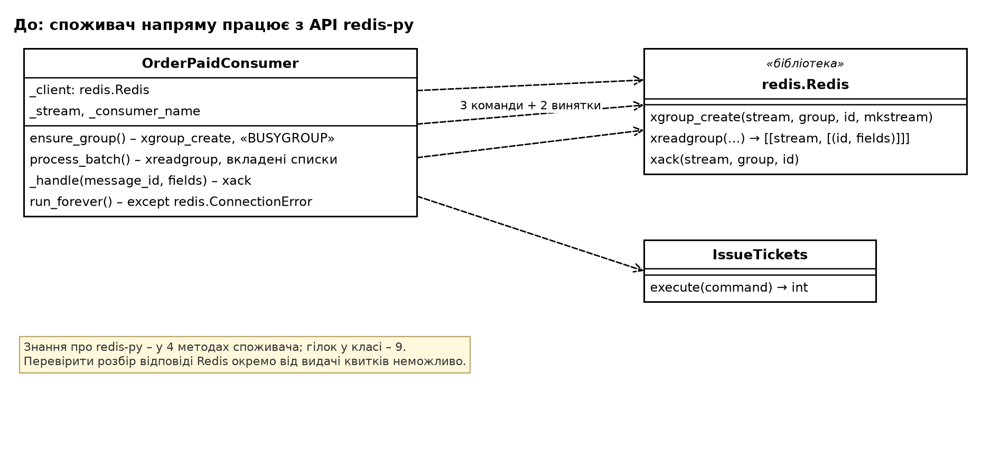
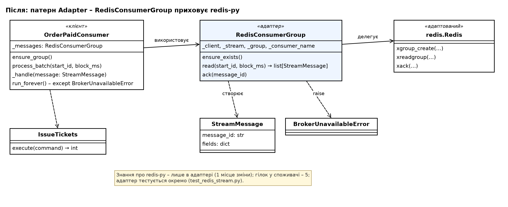

# Патерни проєктування в рефакторингу коду (ЛР 4)

Робота виконана на коді після ЛР 3 (тег `lab-3`, гілка `feature/lab4-patterns`). Порядок – за методичкою ЛР 4, розділ 3: знайти проблеми → обрати патерн і розглянути альтернативу → зафіксувати поведінку характеризаційними тестами → рефакторинг малими кроками з запуском тестів після кожного → порівняти показники до і після.

Показники виміряно скриптом [`tools/measure.py`](../../tools/measure.py) (гілки виконання, рядки, вихідні залежності класу): до змін – [`metrics-before.txt`](metrics-before.txt), після – [`metrics-after.txt`](metrics-after.txt).

## 1. Виявлені проблеми

Рядки вказано для стану до рефакторингу (тег `lab-3`).

| № | Місце в коді | Ознака (табл. 4.1) | Проблема в термінах наслідків | Патерн | Група | Відповідальний |
| --- | --- | --- | --- | --- | --- | --- |
| К-1 | `sales/domain/order.py:69–99` – `start_payment`, `start_or_resume_payment`, `cancel_payment`, `confirm_payment`, `_ensure_not_paid` | ланцюг умов за станом об'єкта | Правило «яка операція оплати дозволена в якому стані» розкидане по чотирьох методах шістьма умовами `if self.status …`; новий стан замовлення (наприклад, «скасоване» для повернення квитка – зміна 6 з ЛР 3) вимагає переглянути й змінити кожен метод | State | поведінкові | Шавейко |
| К-2 | `tickets/infrastructure/order_paid_consumer.py:46–85` – `ensure_group`, `process_batch`, `_handle`, `run_forever` | несумісний інтерфейс зовнішньої бібліотеки | Споживач події напряму залежить від незручного інтерфейсу redis-py (вкладені списки відповіді XREADGROUP, текст помилки «BUSYGROUP», винятки бібліотеки): зміна формату відповіді (наприклад, протокол RESP3 повертає словник) чи брокера зачіпає чотири методи, а логіку розбору відповіді Redis неможливо перевірити окремо від логіки обробки подій | Adapter | структурні | Пакін |
| К-3 | `sales/infrastructure/demo_data.py:14–31` (і 7 викликів у 6 тестових модулях, що будують `Event` так само) | складне створення об'єкта, розкидане по кількох місцях | Створення заходу вимагає вручну узгоджувати ключі двох словників з ідентичністю об'єктів (назва категорії, позиція місця) і писати вкладені цикли за рядами; помилковий ключ `Event` не помічає, а зміна конструктора `Event` у ЛР 3 (поле `starts_at`) змусила правити 8 місць | Builder | породжувальні | Шавейко |
| К-4 | `sales/config/container.py:36–51` – `Container.__init__` | складне створення, жорстко вшите в одне місце | Контейнер сам створює HTTP-клієнт payments і клієнт Redis з налаштувань Django під час імпорту модуля: щоб зібрати sales з іншою реалізацією (тест складання, запуск без Docker), треба змінювати клас, а помилки складання (як забутий `import redis` у ЛР 3) видно лише під час запуску сервісу – перевірити складання можна тільки в окремому процесі й без оплати | Factory Method | породжувальні | Пащенко |

Обрано чотири патерни з трьох груп GoF: поведінкова (State), структурна (Adapter), породжувальна (Builder, Factory Method).

### 1.1. Розглянуті й відхилені кандидати («нічого не змінювати»)

| Місце | Можливий патерн | Чому не застосовано |
| --- | --- | --- |
| `sales/application/pay_order.py` – після оплати подія лише додається у вихідну чергу | Observer | Реакція одна; розсилку кільком споживачам уже забезпечують групи споживачів Redis Streams. Observer тут – «патерн заради патерна» |
| `tickets/infrastructure/order_paid_consumer.py` – `to_command` перевіряє `schema_version == 1` | Strategy (декодер на кожну версію) | Версія одна, а контракт визначає v2 як новий потік – з новим споживачем. Інтерфейс з однією реалізацією – передчасне узагальнення (табл. 4.3) |
| `payments/infrastructure/sqlite.py`, `tickets/infrastructure/sqlite.py` – повторюється відкриття з'єднання | Template Method | Сервіси не можуть ділити код (контракт `independence`), а в кожному сервісі один SQLite-репозиторій – базовий клас мав би одного нащадка |
| `Seat` і `Ticket` – умови за станом | State | По одній умові на метод, три стани; виграшу в показниках немає |
| `InMemoryOutbox` – блокування в кожному методі | Decorator | Клас один; потокобезпечність репозиторіїв sales – це виправлення помилки (зміна поведінки), а не рефакторинг – у ЛР 5 разом із БД |

## 2. Обґрунтування вибору

### К-1. State – стани замовлення

- **Альтернатива 1 – нічого не змінювати.** Три стани й шість умов ще читаються, але кожна нова операція чи стан множить умови в усіх методах; правило «оплачене не можна оплатити» вже дублювалося (`_ensure_not_paid` у двох методах).
- **Альтернатива 2 – таблиця переходів** `{(стан, операція): новий стан}`. Компактна, але не вміщує правила з даними (строк резервування в `start_payment`) і різні повідомлення про помилки – їх довелося б тримати окремими умовами.
- **Альтернатива 3 – Strategy.** Структурно схожа, але стратегію обирає клієнт ззовні й вона не змінюється сама; тут поведінка залежить від внутрішнього стану, який змінюється самими операціями, – це State.
- **Рішення.** Клас стану на кожне значення `OrderStatus` (`AwaitingPayment`, `PaymentPending`, `Paid`), базовий `OrderState` містить заборонені переходи з однаковими повідомленнями, підклас перевизначає лише дозволені. `Order` зберігає лише `status` (його бачать репозиторії, шаблони, тести) і делегує рішення об'єкту стану, який повертає наступний стан. Стани не мають даних, тож для кожного є один екземпляр (`STATES`).

### К-2. Adapter – Redis Streams для споживача tickets

- **Альтернатива 1 – нічого не змінювати.** Працює, але знання про redis-py розкидане по чотирьох методах споживача.
- **Альтернатива 2 – Facade.** Спрощує складну підсистему з багатьма точками входу; тут точок три, а проблема саме в несумісному форматі відповіді та помилок – це задача адаптера.
- **Рішення.** `RedisConsumerGroup` (`tickets/infrastructure/redis_stream.py`) перетворює інтерфейс redis-py на потрібний споживачу: `ensure_exists()`, `read(start_id, block_ms) → list[StreamMessage]`, `ack(message_id)`; наявна група ігнорується, обрив з'єднання – власний `BrokerUnavailableError`. Окремий інтерфейс (ABC) не вводився: реалізація одна, а мета – ізолювати чужу бібліотеку, а не підтримати кілька брокерів. Конструктор `OrderPaidConsumer(client, …)` збережено, щоб не змінювати тести й `container.py`.

### К-3. Builder – створення заходу зі схемою залу

- **Альтернатива 1 – нічого не змінювати.** Демо-захід один, тож це найменш гостра проблема.
- **Альтернатива 2 – фабрична функція з параметрами** (`make_hall(sections=[…])`). Простіша, але список параметрів росте з кожним видом сектору, а необов'язкові частини (категорія, відмінна від сектору) погано виражаються позиційними параметрами.
- **Рішення.** `EventBuilder` у домені (`sales/domain/event_builder.py`): `.sales_start()`, `.starts_at()`, `.category(назва, ціна)`, `.seats(сектор, rows, numbers, category=None)`, `.build()`. Ключі словників будівник формує сам, порядок місць зберігає, дублікат місця відхиляє; інваріант «відома категорія» і далі перевіряє `Event`. Існуючі тестові модулі не переписувались – тести мають проходити без змін.

### К-4. Factory Method – складання sales

- **Альтернатива 1 – параметри конструктора** `Container(payment_gateway=None, publisher=None)`. Додає гілки «якщо не передали – створити» і змішує замовчування зі складанням.
- **Альтернатива 2 – Abstract Factory** (сімейство інфраструктурних об'єктів). Надмірно: змінних продуктів два й вони незалежні.
- **Рішення.** Фабричні методи `create_payment_gateway()` і `create_event_publisher()` повертають доменні інтерфейси `PaymentGateway` і `EventPublisher`; підклас контейнера перевизначає лише потрібний метод. Клас перенесено в `sales/config/composition.py` і він отримує налаштування явно, тож не залежить від Django; `config/container.py` лише створює екземпляр із налаштуваннями Django і запускає «поштар», як і раніше.

### 2.1. Діаграми класів двох найскладніших випадків

К-1, State – до і після:

К-2, Adapter – до і після:

## 3. Збереження поведінки

Перед рефакторингом додано 31 характеризаційний тест (коміти `779f131` – `6dbd8ad`):

| Тест | Що фіксує |
| --- | --- |
| `tests/sales/domain/test_order_transitions.py` (18) | повна таблиця «стан × операція» для `Order`: новий стан або точний тип і текст винятку; відхилена операція не змінює стан |
| `tests/tickets/infrastructure/test_order_paid_consumer_protocol.py` (9) | команди Redis і їхні аргументи, наявна група, повідомлення без `payload`, порядок читання «0» → «>», повторне підключення після обриву з'єднання |
| `tests/sales/infrastructure/test_demo_data.py` (3) | ідентифікатор, назва, дати, ціни, склад і порядок 56 місць демо-заходу |
| `tests/sales/config/test_container_wiring.py` (1) | складання sales в окремому процесі: реалізації, адреси й тайм-аути, спільні сховища й вихідна черга, запущений «поштар» |

Після характеризаційних комітів жоден наявний тест не змінювався (`git diff 6dbd8ad HEAD -- tests` – лише 4 нові файли). Під час кроку `3a68f4a` характеризаційний тест повторного підключення впав: адаптер уже перетворював `ConnectionError` на `BrokerUnavailableError`, а цикл споживача ще чекав виняток redis-py. Крок виправлено в тому самому коміті перехопленням обох винятків, а наступний крок прибрав старий.

Наскрізна перевірка в Docker Compose після рефакторингу: резервування → оплата → квиток → вхід через шлюз працюють; повторна оплата – «Замовлення вже оплачене.»; повторний QR – «Квиток уже використано»; сценарії Б і В експерименту ЛР 3 повторено: подія чекала (`lag` = 1, «Redis недоступний – повторна спроба за 1 с.»), квитки видано після відновлення.

Разом: 192 тести (142 з ЛР 3 + 31 характеризаційний + 19 тестів нових класів), `lint-imports` – 3 kept, 0 broken.

## 4. Показники до і після (форма табл. 4.2)

### К-1. State – `Order`

| Показник | До | Після | Коментар |
| --- | --- | --- | --- |
| Гілки в методах оплати `Order` | 6 | 0 | умови замінено делегуванням стану; у класі лишилися 2 гілки (`__post_init__`, `for_reservation`) |
| Гілки в класі `Order` разом | 8 | 2 | єдина умова правил оплати – строк резервування в `AwaitingPayment.start_payment` |
| Місця зміни для нового стану | 6 | 3 | до: значення enum + 4 методи + `_ensure_not_paid`; після: значення enum + клас стану + рядок у `STATES` |
| Вихідні залежності `Order` | 10 | 10 | винятки правил оплати перейшли в стани, натомість `OrderStatus` і `state_of` |
| Ізольоване тестування правил стану | ні | так | `test_order_state.py` перевіряє стани без `Event`, `Reservation` і `Order` |

### К-2. Adapter – `OrderPaidConsumer`

| Показник | До | Після | Коментар |
| --- | --- | --- | --- |
| Місця зміни при зміні API redis-py чи брокера | 4 | 1 | до: 4 методи споживача; після: лише `RedisConsumerGroup` |
| Гілки в класі споживача | 9 | 5 | розбір вкладеної відповіді й «BUSYGROUP» перейшли в адаптер |
| Залежність від сторонньої бібліотеки redis під час виконання | так | ні | лишилася тільки анотація типу параметра `client` |
| Вихідні залежності споживача | 4 | 6 | більше, але це власні прості типи (`RedisConsumerGroup`, `StreamMessage`, `BrokerUnavailableError`) замість чужого API |
| Ізольоване тестування перетворення відповіді Redis | ні | так | `test_redis_stream.py` – без логіки видачі квитків |

### К-3. Builder – створення `Event`

| Показник | До | Після | Коментар |
| --- | --- | --- | --- |
| Гілки (цикли) в `seed_demo_event` | 3 | 0 | ряди й номери задаються діапазонами |
| Рядки коду `seed_demo_event` | 16 | 11 | |
| Ключі словників, які треба вручну узгоджувати з об'єктами | 2 | 0 | ключі формує будівник |
| Місця зміни при зміні конструктора `Event` (робочий код) | 1 | 1 | без змін: у робочому коді захід створює лише `demo_data` |
| Місця зміни при зміні конструктора `Event` (тести) | 7 | 7 | без змін: наявні тести не переписувались за умовою ЛР 4; для нових тестів і репозиторію БД у ЛР 5 – 1 місце (будівник) |

### К-4. Factory Method – `Container` sales

| Показник | До | Після | Коментар |
| --- | --- | --- | --- |
| Зміна класу `Container` для іншої реалізації шлюзу чи брокера | так | ні | досить підкласу з одним методом |
| Залежність класу складання від Django | так | ні | налаштування передаються явно (`SalesConfig`) |
| Перевірка складання з оплатою й публікацією | ні | так | `test_composition.py`: резервування → оплата → вихідна черга → публікація в тому самому процесі |
| Час тесту складання | 1,27 с | < 0,01 с | окремий процес не потрібен |
| Вихідні залежності `Container` | 15 | 16 | − `settings`, + інтерфейси `PaymentGateway` і `EventPublisher` |
| Гілки в `Container` | 0 | 0 | |

## 5. Історія комітів

| Коміт | Крок |
| --- | --- |
| `be5766e` | скрипт показників і вимірювання до змін |
| `779f131` | характеризаційні тести переходів `Order` |
| `f368125` | характеризаційні тести роботи споживача з Redis Streams |
| `2facaaf` | характеризаційні тести демо-заходу |
| `6dbd8ad` | характеризаційний тест складання sales в окремому процесі |
| `faa93f5` | К-1: `OrderStatus` перенесено в `order_state.py` (без циклічного імпорту) |
| `9ac182a` | К-1: класи станів з тими самими правилами й тести станів; `Order` їх ще не використовує |
| `cecc8b6` | К-1: `start_payment`, `start_or_resume_payment` делегують стану |
| `22e20b2` | К-1: `cancel_payment`, `confirm_payment` делегують стану; прибрано `_ensure_not_paid` |
| `3fb35b9` | К-2: адаптер `RedisConsumerGroup` і його тести; споживач його ще не використовує |
| `3a68f4a` | К-2: читання й підтвердження через адаптер; цикл перехоплює обидва винятки |
| `ce6343c` | К-2: створення групи через адаптер; споживач більше не імпортує redis під час виконання |
| `62383f1` | К-3: `EventBuilder` і його тести |
| `e6e2301` | К-3: демо-захід створюється будівником |
| `2e42c80` | К-4: фабричні методи `create_payment_gateway`, `create_event_publisher` |
| `3979237` | К-4: `Container` перенесено в `composition.py` з явними налаштуваннями |
| `526947f` | К-4: тест складання без мережі через перевизначення фабричних методів |

## 6. Висновки

- **Виправдані:** К-1 (State) і К-2 (Adapter) – найбільше покращення: умови правил оплати зникли з `Order`, а знання про redis-py зосереджене в одному класі; обидва дали можливість тестувати частину окремо.
- **К-4 (Factory Method)** виправданий як засіб тестування: складання sales уперше перевіряється разом з оплатою й публікацією без мережі. Кількість залежностей не зменшилася – це чесна ціна явних інтерфейсів.
- **Найменший ефект – К-3 (Builder):** робочий код створює захід лише в одному місці, а тестові модулі за умовою роботи не переписувались. Користь проявиться в ЛР 5, коли захід відновлюватиметься з БД і з'являться нові тести; до того будівник – радше підготовка, ніж усунення гострої проблеми.
- Характеризаційні тести себе виправдали: один із них зупинив крок, після якого споживач перестав би відновлюватися після обриву з'єднання з Redis.
