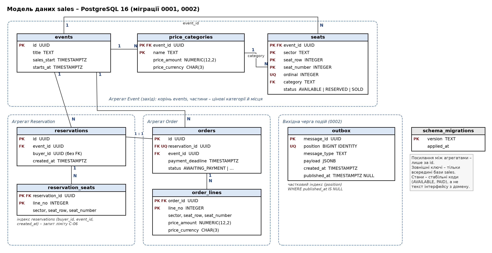
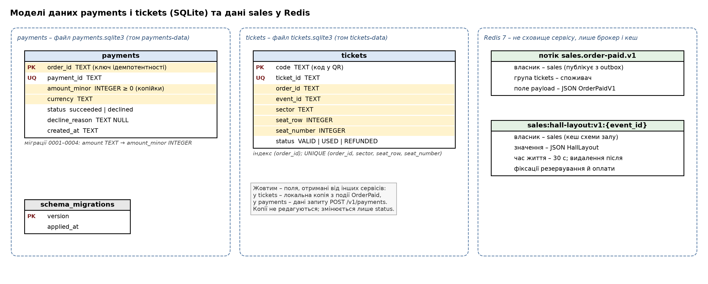

# Архітектура даних: володіння, кешування та узгодженість (ЛР 5)

Робота виконана на системі після ЛР 4 (тег `lab-4`, гілка `feature/lab5-data-architecture`). Порядок – за методичкою ЛР 5, розділ 3: модель даних кожного сервісу → матриця володіння → локальна копія → міграція «розширення – скорочення» → кеш найчастішого читання → узгодження через подію з ідемпотентним обробником → вимірювання до і після кешу. Рішення про сховище sales зафіксовано в [ADR-005](../adr/0005-sales-storage-postgresql.md).

Що змінилося порівняно з ЛР 3:

- **sales** зберігає дані у власній базі **PostgreSQL 16** (контейнер `sales-db`, том `sales-data`) замість пам'яті процесу; вихідна черга подій – таблиця `outbox` у тій самій базі (транзакційний outbox).
- **payments** отримав механізм міграцій і перейшов із текстової суми на копійки чотирма міграціями за шаблоном «розширення – скорочення».
- **sales** кешує схему залу в Redis з інвалідизацією після фіксації транзакції.
- **tickets** гарантує ідемпотентність обробника `OrderPaid` ще й на рівні бази (унікальний індекс).

## 1. Модель даних кожного сервісу

Кожен сервіс має власне сховище; рядок підключення одного сервісу не трапляється в конфігурації іншого (перевірка з табл. 5.3). Redis не є сховищем жодного сервісу – це брокер подій і кеш.

| Сервіс | Сховище | Таблиці | Міграції |
| --- | --- | --- | --- |
| sales | PostgreSQL 16, `sales-db` | `events`, `price_categories`, `seats` (агрегат Event); `reservations`, `reservation_seats` (Reservation); `orders`, `order_lines` (Order); `outbox`; `schema_migrations` | `sales/infrastructure/postgres/migrations/0001_initial.sql`, `0002_outbox.sql` |
| payments | SQLite, файл у томі `payments-data` | `payments`, `schema_migrations` | `payments/infrastructure/migrations/0001`–`0004` |
| tickets | SQLite, файл у томі `tickets-data` | `tickets` | схема з `IF NOT EXISTS`, лише додавання (індекси) |

Правила моделі sales:

- **Агрегат – головна таблиця й таблиці його частин.** `Event` → `price_categories`, `seats`; `Reservation` → `reservation_seats`; `Order` → `order_lines`. Між агрегатами – посилання лише за ідентифікатором (`orders.event_id`, `orders.reservation_id`), як у доменній моделі ЛР 2.
- **Зовнішні ключі – тільки всередині бази sales.** `buyer_id` зберігається без зовнішнього ключа: покупець не належить sales.
- **Стани – стабільні коди** (`AVAILABLE`, `RESERVED`, `SOLD`; `AWAITING_PAYMENT`, `PAYMENT_PENDING`, `PAID`), а не значення enum із домену («вільне», «оплачене»): це текст інтерфейсу, і його зміна не повинна змінювати дані. Те саме – у tickets (`VALID`, `USED`, `REFUNDED`).
- **Гроші** в sales – `NUMERIC(12, 2)` і код валюти (точно, як `Decimal`), у payments – ціле число копійок.
- `seats.ordinal` зберігає порядок місць у схемі залу: без нього `ORDER BY` віддав би «VIP» раніше за «Партер».

Реалізація – репозиторії на `psycopg` (`sales/infrastructure/postgres/repositories.py`), які перетворюють агрегат на рядки й назад. Домен про SQL не знає: від ЛР 4 у доменному шарі змінилися лише інтерфейси репозиторіїв – додано `get_for_update()` (розділ 7). Однакові тести-контракти проходять обидві реалізації – у пам'яті й у PostgreSQL (`tests/sales/infrastructure/test_repository_contract.py`).

## 2. Матриця володіння даними (форма табл. 5.1)

Правило з ЛР 3: **власник – сервіс, який ухвалює рішення про зміну сутності**; у кожної сутності рівно один власник. Решта сервісів або отримують дані від власника в запиті чи події, або зберігають локальну копію лише для читання.

| Сутність (глосарій) | Власник | Споживачі | Спосіб отримання |
| --- | --- | --- | --- |
| Захід (`Event`) | sales | tickets | локальна копія `event_id` з події `OrderPaid` (розділ 3) |
| Місце (`Seat`) зі станом | sales | tickets | локальна копія позиції (сектор, ряд, номер) у квитку з події `OrderPaid`; стан місця не копіюється |
| Цінова категорія (`PriceCategory`) | sales | – | – (ціна фіксується в рядку замовлення всередині sales) |
| Схема залу (`HallLayout`) | sales (похідне подання `Event`) | браузер покупця | запит до sales через шлюз; кеш у Redis належить sales (розділ 5) |
| Резервування (`Reservation`) | sales | – | – |
| Замовлення (`Order`) | sales | payments; tickets | payments – `order_id`, сума й валюта в синхронному запиті `POST /v1/payments` (зберігаються як ключ ідемпотентності); tickets – `order_id` з події `OrderPaid` |
| Подія «замовлення оплачено» (`OrderPaid`) | sales (таблиця `outbox`, потік `sales.order-paid.v1`) | tickets | асинхронно, Redis Streams, група споживачів `tickets` |
| Платіж (`Payment`) | payments | sales | відповідь на синхронний запит (статус, причина відмови); звірка – `GET /v1/payments/{order_id}` за контрактом |
| Квиток (`Ticket`), валідація (`validate()`), повернення (`refund()`) | tickets | покупець, контролер (`Inspector`) | сторінки tickets через шлюз (`/tickets/orders/…`, `/validate/`) |
| Покупець (`Buyer`) | зовнішній постачальник ідентичності (у цільовій архітектурі – сервіс автентифікації; у ЛР поки немає) | sales | лише ідентифікатор `buyer_id`; у цільовій архітектурі – твердження в токені доступу, як у прикладі табл. 5.1 |
| Майданчик (`Venue`), Організатор (`Organizer`) | sales (цільова архітектура, «Продаж»); у коді ще не моделюються | – | – |

Жодна сутність не має двох власників; жоден сервіс не читає чуже сховище: sales не знає про файли SQLite, payments і tickets – про PostgreSQL.

## 3. Локальна копія: квиток у tickets

tickets зберігає частину даних sales у таблиці `tickets`. Копія створюється лише з події `OrderPaid` і **ніколи не редагується локально**: після видачі квитка tickets змінює тільки власне поле `status` (дійсний → використаний / повернений). Тому копія не порушує принципу єдиного джерела істини (умови з розділу 1.1 методички).

| Поле з `OrderPaid` | Копіюється | Для якого власного рішення tickets |
| --- | --- | --- |
| `order_id` | так | ключ ідемпотентності обробника (розділ 6); сторінка «Мої квитки» за замовленням |
| `event_id` | так | `Ticket.validate(event_id)` пропускає лише на свій захід (С-07) |
| `seats[].sector`, `row`, `number` | так (по рядку на місце) | що показати контролеру після успішної валідації; унікальність квитка на місце замовлення |
| `event_title` | ні | tickets не ухвалює рішень за назвою; сторінка «Мої квитки» показує коди квитків |
| `event_starts_at` | ні | правила «вхід не раніше ніж за 2 години» ще немає; коли з'явиться – додати стовпець розширювальною міграцією й заповнювати з подій (поле вже є в `OrderPaid` v1) |
| ціна | ні (і в подію не потрапляє) | повернення коштів – рішення payments |

**Розбіжність із планом ЛР 3.** У `docs/lab3/service-boundaries.md` (розділ 4.2) копію заплановано ширшою – з назвою й часом початку заходу; фактично tickets ці поля не зберігав. Під час ЛР 5 ми перевірили кожне поле за правилом «копіюється лише те, що потрібне для власних рішень» і свідомо лишили мінімальну копію; подія `OrderPaid` v1 ці поля вже містить, тож розширення копії не потребуватиме змін у sales.

Ціна дублювання: зміну назви чи часу заходу після продажу tickets не побачить – але й не мусить, бо цих полів не зберігає. Якщо колись знадобляться, власник має публікувати подію про зміну заходу.

## 4. Міграція «розширення – скорочення»: сума платежу в копійках

**Навіщо.** У payments сума зберігалася текстом (`amount TEXT`, напр. `"1200.00"`): SQLite не порівнює й не підсумовує текст як гроші, а звірка платежів і звіти організатора потребують цього. Новий формат – ціле число копійок `amount_minor INTEGER`. Доменний `Money` не змінюється – перетворення в репозиторії.

**Механізм.** `payments/infrastructure/migrate.py`: пронумеровані SQL-файли, журнал `schema_migrations`, кожна міграція разом із записом про неї – одна транзакція; параметр `target` застосовує міграції до заданого номера (потрібно тестам сумісності). Міграції виконуються під час старту сервісу.

| Міграція | Етап (розділ 3, п. 4 методички) | Що робить | Версія коду після неї |
| --- | --- | --- | --- |
| `0001_initial.sql` | базова схема | схема ЛР 3 з `IF NOT EXISTS`: у наявних базах лише фіксує версію | v1 – пише й читає `amount` |
| `0002_expand_amount_minor.sql` | **додати нову структуру** | стовпець `amount_minor`; обидва стовпці тимчасово допускають NULL, `CHECK` – хоча б один заповнений | v2 – **паралельний запис** в обидва, читання `amount` |
| `0003_backfill_amount_minor.sql` | перенесення даних | копійки для рядків, записаних до паралельного запису | v3 – **читання переведено** на `amount_minor`, запис ще в обидва |
| – | | | v4 – запис лише `amount_minor` (можливий, бо після 0002 `amount` допускає NULL) |
| `0004_contract_drop_amount.sql` | **вилучити стару структуру** | `amount` вилучено, `amount_minor NOT NULL CHECK (≥ 0)` | v4 |

SQLite не вміє змінювати обмеження наявних стовпців, тому 0002 і 0004 перебудовують таблицю (нова таблиця → копіювання → перейменування) в одній транзакції; у PostgreSQL це були б `ALTER COLUMN … DROP NOT NULL` / `SET NOT NULL` і `ADD`/`DROP COLUMN`. Лістинги всіх міграцій – у звіті.

**Порядок розгортання:** 0002 → усі екземпляри на v2 → 0003 → v3 → v4 → 0004. Під час поступового розгортання поруч працюють дві сусідні версії, тож кожна мусить читати рядки іншої.

**Доказ сумісності** – `tests/payments/infrastructure/test_schema_compatibility.py`: SQL кожної версії коду «заморожено» в тесті, тож тести не змінювалися, коли робочий код переходив на наступну версію.

| Після міграції | Перевірено |
| --- | --- |
| 0002 | рядки ЛР 3 збереглися; **v1 (ЛР 3) працює**; v1 і v2 читають рядки одна одної; платіж без суми відхиляється |
| 0003 | копійки для `"1200.00"`, `"600"`, `"0.10"`, `"12.5"`, `"99999.99"`, `"0"`; рядки v2 не змінено; v2 і v3 читають рядки одна одної; v3 читає рядок v4 без `amount` |
| 0004 | усі суми на місці незалежно від версії, що їх записала; v4 працює, `amount` немає; **0004 до переходу на v4 зламав би v3** (документує, чому порядок важливий); пропущена 0003 – 0004 відкочується, суми не губляться |

Перевірка «зламати → тест червоний»: перейменування стовпця одним кроком (`ALTER TABLE payments RENAME COLUMN amount TO amount_minor` замість 0002) – `test_after_0002_v1_still_works` падає: попередня версія коду зупинилася б під час розгортання (типова помилка табл. 5.3).

**На справжніх даних:** том `payments-data` з 10 платежами експериментів ЛР 3–4 пройшов 0001–0004 під час старту – суми від 60000 до 150000 копійок.

У sales міграції – той самий механізм на `psycopg` (`sales/infrastructure/postgres/migrate.py`; окрема копія, бо сервіси не ділять код): DDL у транзакції PostgreSQL і рекомендаційне блокування `pg_advisory_xact_lock`, щоб два екземпляри, що стартують одночасно, не застосували ту саму міграцію двічі. `0002_outbox.sql` – розширювальна міграція (лише нова таблиця).

## 5. Кеш схеми залу (форма табл. 5.2)

Найчастіший сценарій читання – схема залу (С-01): її відкривають усі, хто обирає місця, особливо на старті продажу.

| Параметр | Значення |
| --- | --- |
| Що кешується | результат запиту `GetHallLayout` – `HallLayout` (захід і стан усіх 56 місць демо-заходу). HTML сторінки не кешується: у формі CSRF-токен кожного відвідувача |
| Ключ | `sales:hall-layout:v1:{event_id}`; `v1` – версія формату значення: якщо `HallLayout` зміниться, нова версія коду читатиме `v2` і не зламається на старих записах |
| Час життя | 30 с (`HALL_LAYOUT_CACHE_TTL`; `0` – кеш вимкнено) |
| Умова інвалідизації | подія – зміна стану місць заходу: `ReserveSeats` і `PayOrder` видаляють запис **після фіксації** транзакції; час життя – страховка, якщо видалення не відбулося |
| Поведінка при промаху | читання з PostgreSQL і запис у кеш (cache-aside) |
| Поведінка при відмові Redis | читання з бази; після першого збою кеш вимикається (запобіжник), окремий потік перевіряє `PING`; коли Redis повернувся, записи схем залу видаляються (інвалідизації не доходили) і кеш вмикається знову |

Інтерфейс `HallLayoutCache` – у шарі застосунку поруч із запитом (`sales/application/get_hall_layout.py`), бо момент, коли запис стає недійсним, знають лише сценарії; реалізації – `RedisHallLayoutCache`, `NoHallLayoutCache`, `InMemoryHallLayoutCache` (для тестів) у `sales/infrastructure/hall_layout_cache.py`.

**Чому застарілий кеш не порушує С-03.** Якщо кеш покаже зайняте місце вільним, резервування все одно перевіряє місце в базі під блокуванням і відповість «Місце … вже зайняте». Найгірший наслідок – незручність для покупця, а не подвійний продаж.

**Знахідка під час перевірки відмови.** Перша версія кешу при `docker compose stop redis` віддавала **одну сторінку 7,8 с**: кожне звернення чекало DNS зупиненого контейнера («Name or service not known»), а тайм-аут з'єднання цей етап не обмежує. Звідси запобіжник; з ним при зупиненому Redis p50 – 6,6 мс, як без кешу.

### Вимірювання до і після

Інструменти: `tools/latency.py` (N запитів GET до схеми залу через шлюз, p50/p95/p99, пропускна здатність, навантаження на базу з `pg_stat_database`), `tools/compare_cache.py` (порівняння за однакових умов). Перше вимірювання – до появи коду кешу ([latency-before.txt](latency-before.txt)). Під час повторних серій виявилося, що на Docker Desktop для Windows час відповіді зростає від серії до серії **незалежно від кешу** (без кешу 70,8 → 86,8 → 97,8 мс), тому основне порівняння виконано з перезапуском sales і шлюзу перед кожною серією й чергуванням режимів «без, з, без, з» ([latency-comparison.txt](latency-comparison.txt)); подробиці – [latency-after.txt](latency-after.txt).

| Умови | Показник | Без кешу (2 серії) | З кешем (2 серії) | Зміна |
| --- | --- | --- | --- | --- |
| 1 клієнт, 500 запитів | p50 | 6,6 / 6,6 мс | 5,5 / 5,5 мс | −17 % |
| | p95 | 7,8 / 7,5 мс | 6,5 / 6,2 мс | −17 % |
| | пропускна здатність | 138 / 140 запитів/с | 165 / 167 запитів/с | +19 % |
| 10 клієнтів, 2000 запитів | p50 | 65,7 / 66,1 мс | 50,5 / 50,3 мс | −24 % |
| | p95 | 84,2 / 85,5 мс | 70,5 / 73,0 мс | −15 % |
| | пропускна здатність | 144 / 143 запитів/с | 184 / 185 запитів/с | +28 % |
| обидва | транзакцій бази на перегляд | 1,03–1,09 | 0,02–0,05 | −95 % |
| | прочитаних рядків на перегляд | 64–68 | 0,3–0,9 | −99 % |

Сам запит `GetHallLayout` усередині контейнера: p50 **1,07 мс → 0,27 мс**. Сторінка прискорюється менше, бо її час визначають рендеринг шаблону (≈ 2,3 мс) і HTTP через шлюз (≈ 3,3 мс); головний ефект кешу – **перегляди майже не навантажують базу**, що важливо для піку С-01. Пропускна здатність обмежена одним процесом сервера розробки Django (≈ 140–185 запитів/с) – для експлуатації потрібен gunicorn з кількома процесами (ADR-004).

## 6. Узгодження sales → tickets через подію з ідемпотентним обробником

Ланцюжок: `PayOrder` (крок 3, одна транзакція PostgreSQL) → статус `PAID`, місця `SOLD` і рядок `outbox` → «поштар» `OutboxRelay` раз на 1 с публікує неопубліковані події (`XADD sales.order-paid.v1`) і позначає `published_at` → `tickets-consumer` читає в групі `tickets` → `IssueTickets` видає квитки → `XACK`.

**Транзакційний outbox** (`0002_outbox.sql`, `sales/infrastructure/postgres/outbox.py`) закриває борг ЛР 3: раніше черга була в пам'яті й губила неопубліковані події при перезапуску sales. Тепер оплачене замовлення й подія про нього фіксуються разом або не фіксуються зовсім – це перевіряє `test_failure_after_payment_rolls_back_status_seats_and_event_together`; гарантія з `contracts/order-paid.asyncapi.yaml` («в одній локальній транзакції») тепер відповідає коду.

**Ідемпотентність обробника.** Доставка – «щонайменше один раз»: брокер може доставити подію вдруге (збій споживача до `XACK`), а sales – опублікувати її вдруге (збій між `XADD` і позначкою `published_at`). Ключ ідемпотентності – **`order_id`**, а не `message_id`: так розпізнається і повтор доставки, і повторна публікація з новим ідентифікатором повідомлення. Два рівні захисту:

1. `IssueTickets` перевіряє `exists_for_order(order_id)` – повтор нічого не змінює, у журналі «повторне повідомлення … – квитки вже видано, нічого не змінено»;
2. унікальний індекс `tickets (order_id, sector, seat_row, seat_number)` – якщо дві обробки тієї самої події одночасно пройшли перевірку («перевірити, потім діяти»), друга вставка відхиляється базою й відкочується повністю.

Порядок подій: для одного замовлення подія одна (`OrderPaid`), тож порядок не впливає на результат; коли з'явиться `TicketRefunded`, обробник мусить перевіряти стан квитка, а не покладатися на порядок надходження.

**Доказ ідемпотентності:**

| Перевірка | Результат |
| --- | --- |
| та сама подія доставлена вдруге (`test_same_event_sent_again_does_not_change_result`) | коди квитків **ті самі** (порівнюються коди, а не лише кількість), обидва повідомлення підтверджено |
| та сама оплата з новим `message_id` | квитки не змінилися |
| дві обробки, обидві пройшли перевірку | видано (2, 0); без унікального індексу – (2, 2), тест червоний |
| стара база без індексу | індекс додано під час старту, квитки збереглися |
| **Docker: повторне надсилання тієї самої події** (`tools/resend_last_order_paid.py`) | квиток замовлення `deffecea…` до й після – `qD_udCq0kLYuUZnv76OSww`; у журналі – «повторне повідомлення»; `lag = 0`, `pending = 0` |

## 7. Узгодженість усередині sales: одиниця роботи й блокування

- **Одиниця роботи** (`UnitOfWork` у шарі застосунку, `PostgresUnitOfWork` в інфраструктурі): `ReserveSeats` і кроки `PayOrder` – кожен в одній транзакції PostgreSQL.
- **`get_for_update()`** – `SELECT … FOR UPDATE` на рядку заходу (замовлення): одночасні резервування одного заходу виконуються по черзі. Тест на справжньому PostgreSQL – два потоки резервують те саме місце: успішне рівно одне; без блокування – обидва «зарезервовано» (подвійний продаж).
- **`PayOrder` – три короткі транзакції**, щоб не тримати блокування під час мережевого виклику payments (до 2 с): намір «оплата в обробці» → виклик поза транзакцією → результат із перечитаним під блокуванням заходом. Копія заходу з першого кроку могла застаріти – її збереження затерло б резервування інших покупців (тест `test_reservation_made_during_payment_call_is_not_overwritten`).

## 8. Максимальна тривалість неузгодженості

| Пара даних | Штатний режим | Під час відмови | Чи прийнятно |
| --- | --- | --- | --- |
| Замовлення `PAID` у sales ↔ квитки в tickets | **виміряно 826–957 мс, середнє 868 мс** (`tools/order_paid_lag.py`, [order-paid-lag.txt](order-paid-lag.txt)); межа ≈ 1 с – інтервал «поштаря» + мілісекунди на `XADD`, доставку й запис | вимкнено `tickets-consumer` чи Redis – до відновлення; подія не губиться (outbox, потік, група) | так: покупець бачить «Квитки ще видаються», а квиток потрібен лише на вході (С-07) – за години чи дні; ризик – збій біля початку заходу, тому потрібен моніторинг `lag` групи |
| Замовлення «оплата в обробці» у sales ↔ платіж `succeeded` у payments (тайм-аут, загублена відповідь) | 0 – статус оновлюється у відповіді | до повтору покупцем («Спробувати ще раз»): фонової звірки немає | частково: кошти не списуються двічі (ідемпотентність за `order_id`), місця утримуються; потрібна звірка через `GET /v1/payments/{order_id}` (Celery, наступні ЛР) |
| Стан місць у PostgreSQL ↔ кеш схеми залу | 0 – запис видаляється після фіксації | до 30 с (час життя): гонитва читання із записом або збій Redis; після відновлення Redis кеш очищається | так: застаріла схема не дає продати місце двічі (перевірка під блокуванням) |
| Захід у sales ↔ копія в tickets | неузгодженості немає: копіюються лише поля, що не змінюються після оплати | – | так |

**Відповідь на контрольне питання 9:** у штатному режимі максимальна неузгодженість – близько 1 с між оплатою й появою квитка; вона прийнятна, бо квиток потрібен лише на вході, а оплата й місця вже зафіксовані в sales.

## 9. Сценарії якості ЛР 1 після ЛР 5

| С-xx | Що дала архітектура даних | Що ще потрібно |
| --- | --- | --- |
| С-01 схема залу p95 ≤ 500 мс | p95 6–7 мс (1 клієнт), 70–73 мс (10 клієнтів); перегляди не навантажують базу (−95 % транзакцій) | навантаження Locust на піку, gunicorn |
| С-02 резервування p95 ≤ 1 с | одна транзакція з блокуванням заходу | вимірювання під навантаженням; блокування рядків місць замість заходу – якщо черга на заході стане вузьким місцем |
| С-03 0 подвійних продажів | `SELECT … FOR UPDATE` + тест двох потоків; перечитування заходу в `PayOrder`; кеш не впливає | – |
| С-04 0 втрачених оплат | замовлення й стан «оплата в обробці» переживають перезапуск sales (раніше – пам'ять); транзакційний outbox; суми платежів збережені міграціями | фонова звірка платежів |
| С-05 відхилення повторної оплати | без змін (ідемпотентність payments за `order_id`) | перевірка підпису callback LiqPay |
| С-06 ≤ 6 квитків на покупця | ліміт рахує запит до бази під блокуванням заходу – без гонитви | урахування оплачених місць після 15 хв, автентифікація |
| С-07 повторний QR відхиляється | видача квитків ідемпотентна й захищена унікальним індексом | атомарне оновлення статусу при одночасному скануванні |
| С-08 зміна ≤ 1 модуля | перехід sales на PostgreSQL – інфраструктура й складання; домен – лише `get_for_update()`; міграція суми – лише інфраструктура payments | – |
| С-09 розгортання ≤ 30 хв | міграції застосовуються автоматично під час старту; +1 контейнер (`sales-db`) | окремий крок міграцій для кількох екземплярів |

## 10. Обмеження й технічний борг

- Міграції виконуються під час старту сервісу: для одного екземпляра це просто; для кількох – окремий крок розгортання (у sales одночасний старт уже захищає рекомендаційне блокування, у payments – ні).
- Блокування на рівні заходу серіалізує всі резервування одного заходу – на старті продажу це може стати вузьким місцем (не вимірювалося).
- Кеш: між читанням зі сховища й записом у кеш можлива гонитва з інвалідизацією – застарілість до 30 с; на піку резервувань кожне резервування інвалідизує запис, тож частка влучань знижується саме тоді.
- «Поштар» розрахований на один екземпляр sales; для кількох – `FOR UPDATE SKIP LOCKED`. Опубліковані рядки `outbox` не видаляються – потрібне періодичне очищення.
- Схема tickets змінюється лише додаванням (`IF NOT EXISTS`); для несумісних змін знадобиться механізм міграцій, як у payments.
- Немає фонової звірки «оплата в обробці» (борг ЛР 3).
- Сервер розробки Django; облікові дані бази sales (`sales/sales`) – для розробки. Попередження Django «unapplied migration(s)» стосується вбудованих застосунків `admin`, `auth`, які sales не використовує.
- Вимірювання на Docker Desktop для Windows мають розкид між серіями – тому порівняння виконано з перезапуском і чергуванням режимів.

## 11. Автоматична перевірка

251 тест (250 пройдено, 1 пропущено – перевірка відкату транзакції для сховища в пам'яті), `lint-imports` – 3 контракти виконано. Інтеграційні тести PostgreSQL отримують кожен власну порожню схему (`tests/sales/infrastructure/conftest.py`); без контейнера `sales-db` вони пропускаються з поясненням, а доменні тести від бази не залежать.

| Набір | Тестів | Нове в ЛР 5 |
| --- | --- | --- |
| sales | 148 | міграції PostgreSQL (4), контракт репозиторіїв для пам'яті й PostgreSQL (14), конкурентне резервування (1), перезапис резервувань у `PayOrder` (1), outbox (4), кеш у сценаріях (4) і в Redis (4), «поштар» при збої сховища (1) |
| payments | 51 | механізм міграцій (4), сумісність «розширення – скорочення» (17) |
| tickets | 43 | ідемпотентність на SQLite (4) |
| contracts, architecture | 9 | без змін |

## 12. Історія комітів

| Коміт | Крок |
| --- | --- |
| `66aa5ff` | механізм міграцій payments і базова міграція 0001 |
| `cd2cea2` | розширення: 0002, паралельний запис у `amount` і `amount_minor` |
| `4018721` | перенесення: 0003, читання з `amount_minor` |
| `f179d96` | код більше не пише `amount` |
| `148a50f` | скорочення: 0004 вилучає `amount` |
| `cbc0914` | контейнер PostgreSQL для sales, механізм міграцій, схема 0001 |
| `2f03c59` | репозиторії sales на PostgreSQL і тести-контракти |
| `53dfb6a` | одиниця роботи, `get_for_update`, три транзакції `PayOrder` |
| `88cd2e7` | транзакційний outbox, sales на PostgreSQL у Docker |
| `3662bea` | інструмент вимірювання і вимірювання до кешу |
| `c9405e9` | кеш схеми залу в Redis із запобіжником |
| `bcf2c81` | порівняння часу відповіді без кешу й з кешем |
| `3ef8123` | ідемпотентність обробника `OrderPaid` на рівні бази |
